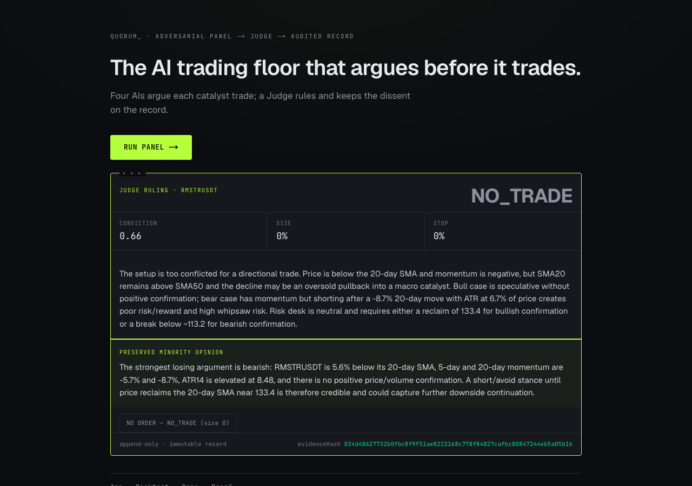
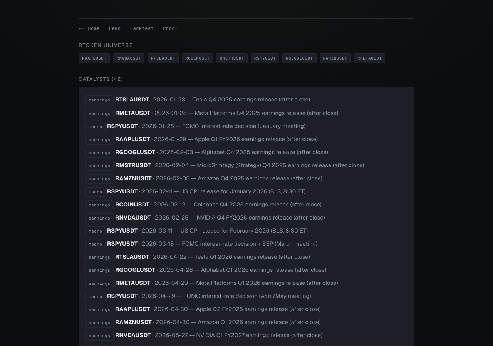
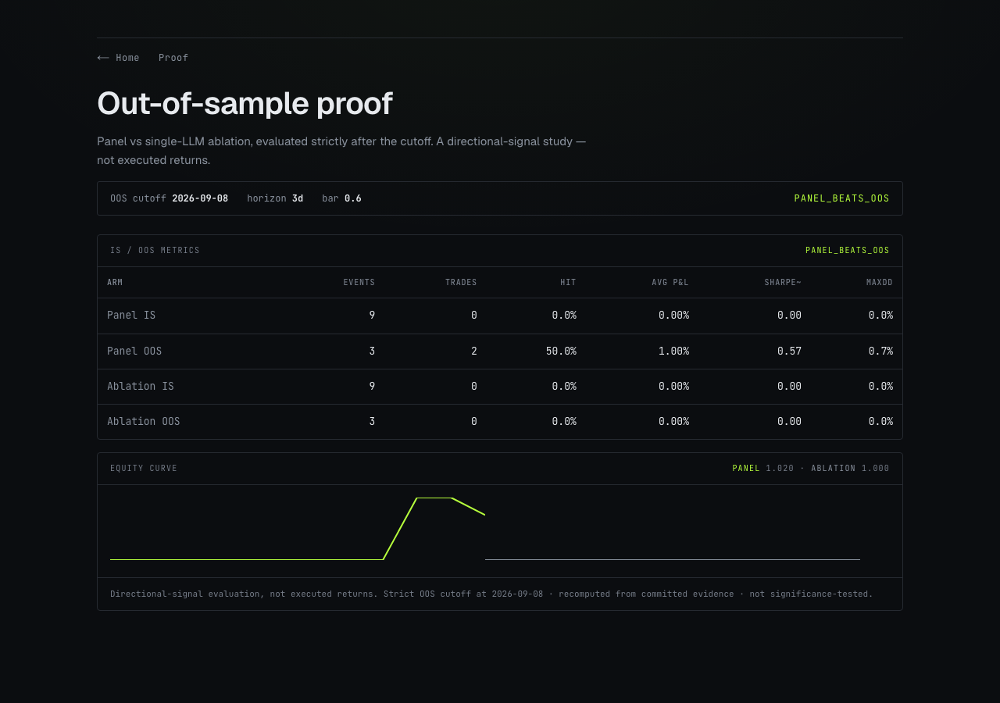
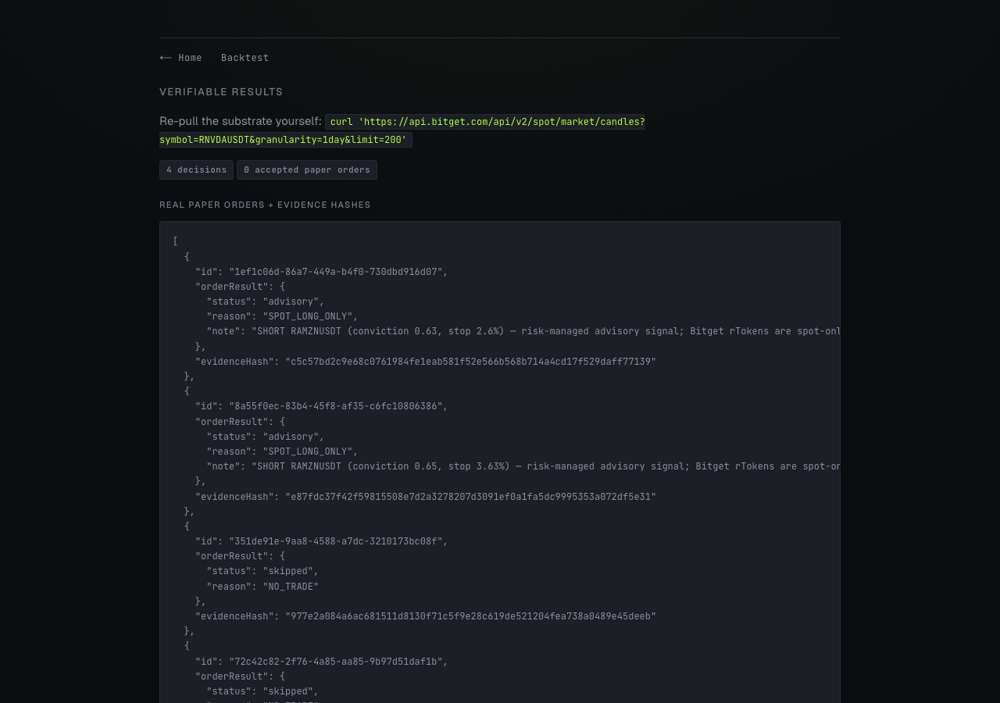
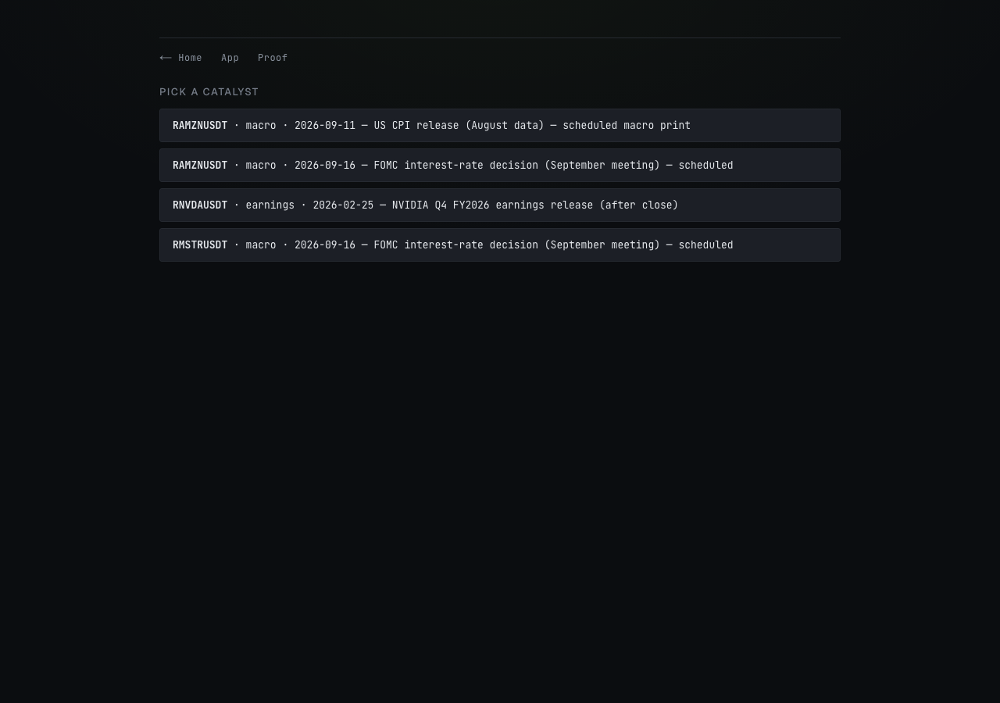

# Quorum

**An adversarial Bull/Bear/Risk LLM panel debates each tokenized-US-stock catalyst; a Judge issues the sole order-triggering decision with the minority opinion preserved on every verdict.**

> Dissent is never erased.




| | |
|---|---|
|  |  |
|  |  |

Built for the Bitget AI Hackathon S2, Agentic Trading track. Codename: Voir Dire.

---

## What Is Quorum?

**The problem.** A single-LLM trader is a confident black box. It emits one voice, erases the argument it rejected, and sizes positions with no built-in risk discipline. When it is wrong, there is no record of the case against the trade.

**The solution.** Quorum runs an adversarial panel: a Bull, a Bear, and a Risk analyst argue each catalyst. A Judge rules on the record, issues the single decision that can trigger an order, and keeps the losing argument as a non-empty minority opinion on every verdict (including NO_TRADE). The whole chain is audited and recompute-verifiable.

**Bitget Agent Hub integration.** Execution routes through `@bitget-ai/bitget-agent-sdk@3.3.1`. OAuth connects a real Agentic sub-account (uid 8808304094, unified/hedge mode), and the order call reaches Bitget's trade API (`submission/proof.md`). Paper trading only, no live money (`BITGET_PAPER_TRADING=true`).

**Two differentiators:**
1. **Preserved dissent on every verdict.** The minority opinion is a first-class, zod-required field, not a footnote. Enforced in `src/core/judge.ts`.
2. **An out-of-sample event study that beats the single-LLM ablation.** A mandatory single-LLM baseline is run under the identical conviction policy, and the verdict is computed from committed data, never asserted.

---

## How It Works

```
Catalyst (rToken earnings / macro event)
        |
        v
Evidence Packet  (price history + technical signal, strict asOf cutoff)
        |
        v
Panel            Bull  /  Bear  /  Risk   (three opposing arguments)
        |
        v
Judge            TradeDecision + preserved minority opinion
        |
        v
Executor         spot LONG -> live-fillable buy
                 SHORT     -> advisory signal (SPOT_LONG_ONLY, no fabricated fill)
        |
        v
Audit store      every decision, with an evidence hash
```

The Judge verdict is the only order call site in the codebase. `placePaperOrder` lives solely in `src/core/executor.ts` (claim C2, grep-proven). This is a structural invariant: the Executor takes a `JudgeVerdict`, never loose order parameters (ADR-004).

---

## Running Locally

```bash
npm install
cp .env.example .env     # fill in LLM + Bitget keys
npm run build
npm run start
```

The demo hero flow replays from a committed on-disk LLM cache (`.llm-cache/`), so it runs offline: state replays from a committed warm cache, and a cold boot serves the hero flow instantly (around 0.004s per cached catalyst). No keys are required to render the seeded decisions and the backtest curve.

Environment variables (`.env.example`):

| Name | Required | Description |
|------|----------|-------------|
| `LLM_BASE_URL` | yes | OpenAI-compatible chat/completions endpoint (AgentRouter gateway) |
| `LLM_API_KEY` | yes | Gateway API key |
| `LLM_CHEAP_MODEL` / `LLM_STRONG_MODEL` | yes | Model ids (default `deepseek-v4-flash`) |
| `LLM_EXTRA_HEADERS` | gateway-dependent | Client-identity headers as JSON |
| `BITGET_API_KEY` / `BITGET_API_SECRET` / `BITGET_PASSPHRASE` | for execution | Bitget Agentic credentials |
| `BITGET_PAPER_TRADING` | yes | Must be `true`, paper only |
| `BITGET_KEY_TYPE` | yes | `agent` for the Agentic OAuth path |
| `BITGET_EXECUTOR_MODE` | yes | `dry-run` previews the order request |
| `NEXT_PUBLIC_BASE_URL` | for deploy | Deployed origin so the server-side `/proof` fetch resolves |

---

## Live Demo

Live: https://quorum-ten-mauve.vercel.app

---

## Honesty Ledger

Every row recomputes from committed data (`docs/pipeline/claims.json`, `CLAIMS.md`). `npm run verify-claims` exits 0 only if the ledger matches an independent recompute.

| Capability / Claim | Status | Evidence |
|--------------------|--------|----------|
| OOS verdict PANEL_BEATS_OOS; panel OOS avg 0.9952% vs ablation 0.0000% | recompute-verified | `evidence/backtest-events.jsonl` (`npm run verify-claims`); directional only, 3 OOS events, 20/32 gateway-skipped, not significance-tested |
| Judge TradeDecision is the sole order call-site | grep-proven | `src/core/executor.ts` (`placePaperOrder` only at executor.ts:28) |
| Every verdict preserves a non-empty minority opinion | test-proven | `evidence/seed-decisions.jsonl` (`npm test test/judge.test.ts`) |
| Strict asOf cutoff: no candle ts>=event date in any packet | test-proven | `src/pipeline/collector.ts` (`npm test test/collector-cutoff.test.ts`) |
| 4 real committed decisions (2 SHORT, 2 NO_TRADE) with evidence hashes | committed | `evidence/seed-decisions.jsonl` |

### Honest constraints (read these)

**Execution is spot-long-only (refined-C).** Bitget lists rTokens spot-only, with no futures or borrow venue (confirmed: RAMZNUSDT has no USDT-FUTURES market). So **LONG** decisions are live-fillable (spot buy), while **SHORT** decisions are emitted as risk-managed advisory signals (`orderResult.status = "advisory"`, reason `SPOT_LONG_ONLY`). The agent still decides and preserves dissent, but no short fill is ever fabricated.

**The technical signal is computed in-app.** The `bitget-signal` package is not installed. Quorum computes its own technical signals (`src/adapters/signal/signal.ts`). It does not claim `bitget-signal` as a live sponsor feed.

**The backtest is a directional-SIGNAL evaluation, not executed-strategy returns.** It measures the value of the panel's calls as signals (long and short), not Bitget-executed strategy returns. Short signals are advisory on spot rTokens. The exact out-of-sample numbers (from `CLAIMS.md`):

- Backtest window 2026-03-10 to 2026-10-08. OOS cutoff 2026-09-08 (at least 30d strictly out-of-sample). Pre-registered policy committed before OOS was touched: `convictionBar=0.6`, `horizonDays=3`.
- Of 32 catalyst events, **20 were dropped by the LLM gateway's content-moderation filter** (a tooling artifact of the AgentRouter gateway plus deepseek-v4-flash, not a modelling choice). **12 events scored (9 IS / 3 OOS).**
- OOS verdict: **PANEL_BEATS_OOS**. **Panel OOS avg P&L: 0.9952%** (2 SHORT trades, hit-rate 50%, stops set). **Ablation OOS avg P&L: 0.0000%** (0 positions cleared its own conviction).
- The exclusions are non-random and the OOS sample (3) is far below a meaningful threshold, so **we make NO alpha claim**. The number is directional and illustrative of the mechanism only.

**Agentic account connected, no live fill.** OAuth connects the real sub-account (uid 8808304094) and the order path reaches Bitget's API, proven at the connection and path level. A live fill additionally requires a funded demo/paper account.

---

## Verify in 60s

```bash
npm run verify-claims
```

This re-derives the OOS verdict and headline numbers from the committed per-event rows (`evidence/backtest-events.jsonl`), never a read-back of the stored result. It exits 0 only if `CLAIMS.md`'s verdict and OOS numbers match the independent recompute, and exits 1 (`CLAIM_MISMATCH`) otherwise. Expected output:

```
OK: PANEL_BEATS_OOS: panel OOS avg 0.995% (hit 50.0%) vs ablation 0.000% (hit 0.0%), independently recomputed from 12 committed event rows.
```

---

## Documentation Suite

- [CLAIMS.md](CLAIMS.md) : the honesty ledger and OOS numbers, each backed by a recompute.
- [DECISIONS.md](DECISIONS.md) : architecture decision records (ADR-001 through ADR-006).
- [SECURITY.md](SECURITY.md) : threat model, structural enforcement, and what is not defended.
- [LIMITATIONS.md](LIMITATIONS.md) : scope, honest findings, and feature-gated items.
- [SUBMISSION_STATUS.md](SUBMISSION_STATUS.md) : build status and known blockers.
- [DESIGN_SYSTEM.md](DESIGN_SYSTEM.md) : brand, color mode, and UI tokens.

---

## Tech Stack

| Layer | Technology |
|-------|------------|
| Framework | Next.js 15 (App Router), React 19 |
| Language | TypeScript 5.5 |
| Validation | Zod |
| Execution | `@bitget-ai/bitget-agent-sdk@3.3.1` (Bitget Agent Hub, paper) |
| LLM | deepseek-v4-flash via AgentRouter gateway (OpenAI-compatible, endpoint-agnostic) |
| Tests | Vitest (37 passing) |

---

## Project Structure

```
src/
  adapters/
    bitget/
      agenthub.ts        # Agent Hub order path (no fabricated fills)
      market.ts          # Bitget rToken candle client (public, no key)
    llm/client.ts        # OpenAI-compatible LLM client (cheap/strong split)
    signal/signal.ts     # in-app technical signal (not bitget-signal)
  core/
    panel.ts             # Bull / Bear / Risk adversarial debate
    judge.ts             # Judge verdict, zod-required minority opinion
    executor.ts          # sole order call site (verdict-only surface)
    backtest.ts          # IS/OOS event study + single-LLM ablation
    audit.ts             # immutable decision store
    metrics.ts           # P&L and hit-rate aggregation
    types.ts             # shared TradeDecision / JudgeVerdict types
  pipeline/
    collector.ts         # Evidence Packet builder, strict asOf cutoff
    run-catalyst.ts      # single-catalyst end-to-end run
  app/
    page.tsx             # landing (money-shot decision card)
    app/page.tsx         # universe + catalyst list + decision log
    app/decision/[id]/   # per-decision audit
    backtest/page.tsx    # Panel vs ablation equity curves
    demo/page.tsx        # single-click hero flow
    proof/page.tsx       # recompute-verifier output + evidence hashes
    api/                 # run, decisions, backtest, proof routes
scripts/
  verify-claims.ts       # independent recompute gate
  backtest.ts            # run the OOS event study
  seed-demo.ts           # produce committed real decisions
  cache-candles.ts       # build the deterministic candle cache
evidence/                # committed backtest rows, seed decisions, proofs
```

---

## License

MIT. See [LICENSE](LICENSE).

## Core Invariants

The safety guarantees that make Quorum's decisions auditable — each is enforced in code and emits an exact rejection code when violated:

- **Single order call-site** — only `Executor.execute(verdict)` can place an order; it takes a Judge `TradeDecision` and nothing else, so removing the LLMs means nothing trades. A bypass attempt yields `NO_VERDICT_NO_ORDER`.
- **Preserved dissent** — every verdict must carry a non-empty `minorityOpinion` (the strongest losing argument), enforced by a zod `.min(1)` schema even on `NO_TRADE`. An empty dissent after retries yields `MINORITY_MISSING`.
- **Out-of-sample cutoff** — no candle at or after the catalyst date may enter an evidence packet; the collector refuses look-ahead data with `OOS_LEAK_GUARD`.
- **Recompute-or-reject** — `verify-claims.ts` independently recomputes the OOS verdict from committed event rows; a stored number that doesn't reproduce raises `CLAIM_MISMATCH`.
- **Honest execution** — rTokens are spot-only, so a `SHORT` is rendered as an honest `advisory` (`SPOT_LONG_ONLY`), never a fabricated fill; a genuinely rejected order surfaces `ORDER_REJECTED`.
